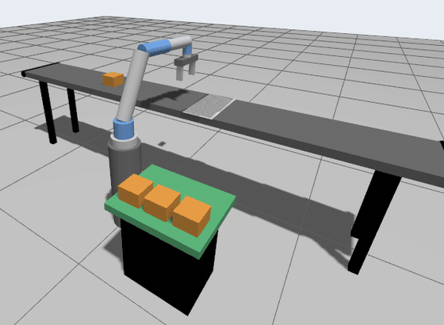
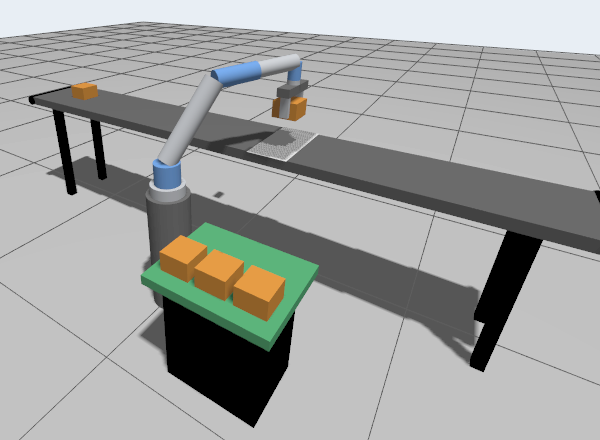
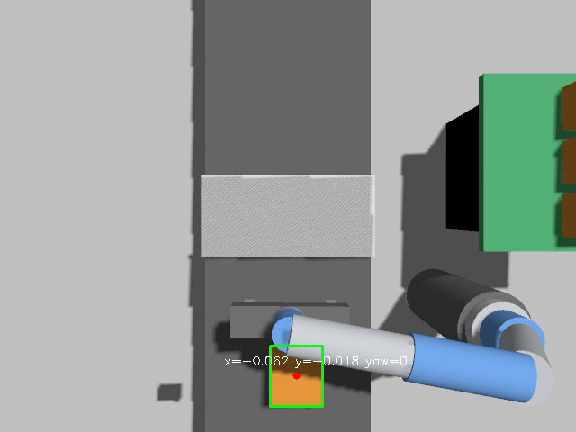
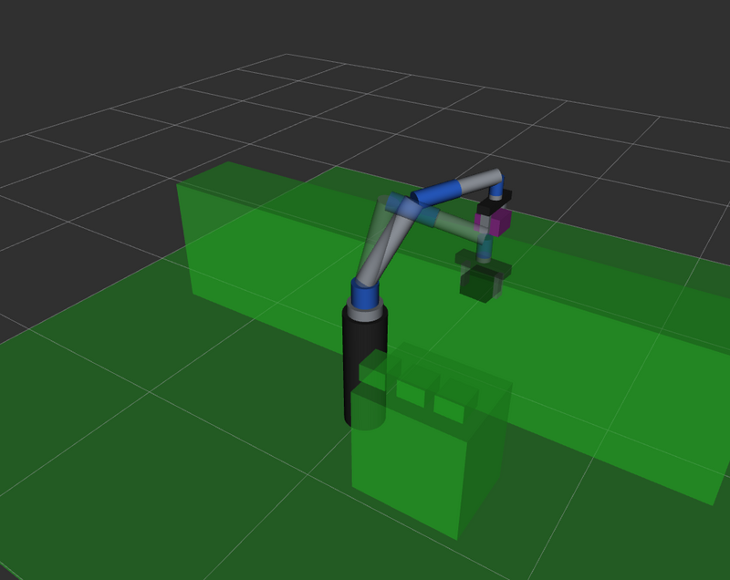

<h1 align="center">Conveyor Pick-and-Place Cell</h1>

<p align="center">
  <b>A 6-DOF arm picks boxes off a <i>moving</i> conveyor using an overhead camera, then stacks them on a table.</b><br>
  ROS 2 Humble · Gazebo Fortress · MoveIt 2 · OpenCV · Docker
</p>

<p align="center">
  
  
  
  
  
</p>

<p align="center">
  
</p>

Boxes ride a conveyor. An overhead camera finds them, and a 6-DOF arm picks each one
**from the moving belt** and places it on a table beside it. The cycle repeats for 6 boxes.
`mode:=stop` keeps the simpler version: stop the belt, then pick.

## Gallery

| The cell in Gazebo | What the overhead camera sees |
|:---:|:---:|
|  |  |
| Arm carrying a box off the belt; three boxes already placed on the table. | HSV threshold → contour → `minAreaRect`, projected to world X/Y with TF2. |

<p align="center">
  <br>
  <sub>RViz: MoveIt planning scene (belt and table as collision objects), the planned trajectory, and the held box attached to the gripper (magenta).</sub>
</p>

## Setup

### Prerequisites

- **Linux with a desktop session** (X11, or Wayland with XWayland). Tested on Ubuntu with an Intel Iris Xe GPU.
- **Docker Engine + Docker Compose v2**: <https://docs.docker.com/engine/install/>.
  Add yourself to the `docker` group so `docker` runs without `sudo`:
  `sudo usermod -aG docker $USER`, then log out and back in.
- **`xhost`** (lets the container open windows): `sudo apt install x11-xserver-utils`
- About **5 GB** of free disk for the image (ROS 2 Humble desktop + MoveIt + Gazebo).

You do **not** need ROS, Gazebo or MoveIt on the host. Everything runs inside the container.

### 1. Clone

```bash
git clone https://github.com/dhanvik1991/pick_place_ws.git
cd pick_place_ws
```

### 2. Match the container to your machine (one time)

`docker-compose.yml` has values specific to the host. Check yours and edit them if they differ:

```bash
id -u; id -g                   # -> UID / GID build args (default 1000 / 1000)
getent group video render      # -> the numbers under group_add (default 44 / 110)
```

- `UID`/`GID` make files the container creates in the workspace owned by you.
- `video`/`render` plus `/dev/dri` give Gazebo GPU rendering. On an NVIDIA GPU, use the
  NVIDIA Container Toolkit instead (`runtime: nvidia` / `gpus: all`).

### 3. Build and run

```bash
./run.sh
```

The first run builds the Docker image. That takes a while, because it downloads several GB. It then runs
`colcon build` inside the container and launches the whole cell. Gazebo opens, boxes begin
spawning after about 8 s, and the arm starts picking. Later runs start in seconds.

Stop with `Ctrl+C`, or run `./stop.sh` from another terminal. To remove the container
completely: `docker compose down`.

## Usage

```bash
./run.sh                 # builds the Docker image on first run, then launches everything
./run.sh rviz:=true      # + RViz: planning scene, planned paths, camera debug image
./run.sh mode:=stop      # stop-and-pick instead of picking on the fly
./stop.sh                # stop the simulation (container keeps running)
./shell.sh               # another shell inside the container
```

Everything runs inside the `pick_place` container. Your host Python/OpenCV is not touched.

## What happens

| Stage | Where |
|---|---|
| Belt drive and box feeding | `scripts/box_spawner.py`: `/conveyor/speed` (Float64, m/s) |
| Box detection: HSV → contour → `minAreaRect` | `scripts/box_detector.py` |
| Pixel → X,Y,Z: intrinsics + TF2 (`world → camera_link → camera_optical`) | `scripts/box_detector.py` |
| Cycle: stop belt → IK → MoveIt plan → linear approach → grip → place | `scripts/pick_place.py` |
| Arm + gripper model and ros2_control | `urdf/arm.urdf.xacro`, `config/controllers.yaml` |
| MoveIt (SRDF, KDL IK, OMPL, controllers) | `config/moveit/`, `config/ompl_planning.yaml` |
| World: belt, table, camera | `worlds/factory.sdf` |

Useful topics: `/boxes/detections` (PoseArray in `world`), `/boxes/debug_image`,
`/conveyor/speed`, `/joint_states`.

## Picking from the moving belt (conveyor tracking)

1. **Wait.** The arm hovers above the belt at x = 0.10 with the gripper open.
2. **Detect.** The camera sees each box upstream. Detections touching the image edge are
   ignored because their centroids are biased. A few frames are averaged and projected to a
   common time with the known belt speed (the role an encoder plays on a real line). Vision
   cross-checks that speed.
3. **Predict.** The pick node computes when the box will reach the gripper (`t_meet`).
4. **Plan.** It builds a trajectory sampled every 0.1 s: move with the belt (x = x0 + v·t),
   line up with the box's lane, descend, hold while the fingers close, and lift. Each waypoint
   gets its own IK solution, seeded from the previous one.
5. **Execute.** The trajectory goes straight to `arm_controller` with `header.stamp = t_meet`,
   so it starts exactly when the box arrives. The gripper close is scheduled the same way.
6. **Measure the grip.** After the lift, the box-in-gripper offset is measured and compensated
   when placing.

Typical numbers: about 8 mm interception error, box placed within 1 mm of its slot, about
21 s per box (boxes arrive 1.5 m apart at 0.07 m/s).

## Simulation shortcuts (and why)

- **Gripping.** Friction grasps in Gazebo slip and jitter. The fingers close around the box.
  Then the pick node swaps the belt box for an identical `held_i` box at the same pose.
  A `DetachableJoint` on the wrist attaches it. Publishing to `/gripper/detach_i` releases it.
  One slot exists per box, because a Fortress DetachableJoint can't be reused.
- **Belt.** The Fortress `TrackController` did not move objects on this machine. Instead,
  each box carries a `VelocityControl` plugin that listens to one shared belt-speed topic.
  The belt surface is frictionless, so friction doesn't drag boxes below the commanded speed.
- **Camera calibration** is the static TF in the launch file. It matches the camera pose in the world.
- **`IGN_IP=127.0.0.1`.** Gazebo transport otherwise binds to the first network interface. Here
  that was a VPN interface, and it silently dropped gripper-release messages.

## Measured results (headless runs in the container)

| | moving belt (default) | `mode:=stop` |
|---|---|---|
| Boxes placed correctly | 6/6 | 6/6 |
| Vision / interception error | about 8 mm interception | 0.7–1.8 mm vision |
| Time per box (sim) | about 21 s | about 24 s |

Every final pose is checked in Gazebo. A box that isn't on its slot is reported as MISPLACED.

Other launch options: `headless:=true` (no Gazebo window), `gz_verbosity:=4` (Gazebo debug log).

## Troubleshooting

| Symptom | Fix |
|---|---|
| `Authorization required` / `could not connect to display` | Run `xhost +SI:localuser:$(id -un)` (`run.sh` does this), and check `echo $DISPLAY` is set. |
| Gazebo is black or very slow | Check that `/dev/dri` exists and that the `group_add` numbers match `getent group video render`. |
| `permission denied ... docker.sock` | You're not in the `docker` group yet: run `sudo usermod -aG docker $USER` and log in again. |
| Boxes don't move, or the gripper never releases | Another ROS 2 / Gazebo instance is interfering. The container uses `ROS_DOMAIN_ID=42` and `IGN_IP=127.0.0.1`. Make sure nothing else uses them, then `./stop.sh` and rerun. |
| Built files owned by root | The `UID`/`GID` build args don't match yours. Fix them and run `docker compose build --no-cache`. |

## Real hardware

A real cell needs properly rated robot hardware, emergency stops, guarding or light curtains,
safety-rated controls and a risk assessment. Simulation does not establish real-world safety.
